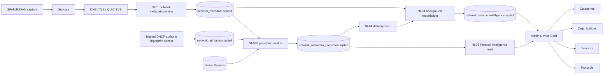

# Network Intelligence V1

Status: **current production capability / functionally closed**
Updated: 2026-10-14
Repository baseline: main@27087766d3f2e104a44da3f36aa6e72a082b12de
Tree: 3fe941f1962e6df72d102ba36da60bf25f3bd70a

Network Intelligence V1 is the production metadata-intelligence path that turns bounded passive network observations into Device-scoped protocol and recognized-service summaries without making the Device Card a packet-analysis engine.

**Program disposition**

| Stage | Current state |
|---|---|
| NI-00 — Capability / Capture Research | Completed |
| NI-01 — Network Metadata Ingestion | Production |
| NI-02 / NI-02B — Device Attribution / Materialized Projection | Production |
| NI-03 — Protocol Intelligence | Production |
| NI-04 — Service Recognition / Background Materialization | Production |
| NI-05 — Organization Context | Production |
| NI-06 — Transport Health | **CANCELLED BY OWNER** |
| Network Intelligence V1 | **FUNCTIONALLY COMPLETE / PRODUCTION DEPLOYED / CLOSED** |

Network Intelligence V1 is separate from Device Fingerprint. Shared capture infrastructure does not merge product semantics:
- Device Fingerprint classifies what kind of Device the evidence supports.
- Network Intelligence describes bounded, supported network-observed protocol/service context for an authoritatively attributed Device.
- Neither subsystem owns guest authorization or CAPPORT.

Full visual reference: [Network Intelligence Visual Architecture Atlas](../network-intelligence/architecture-atlas.md).

## 1. Product questions answered

Current product-safe Network Intelligence can answer:
- which supported protocol families were observed recently;
- which admitted services were recognized recently;
- which organizations are represented by those recognized recent services;
- which service categories those recognized services belong to;
- when the last supported protocol/service observation occurred;
- how fresh the result is;
- whether source, attribution, recognition and materialization coverage are sufficient.

It does **not** claim:
- exhaustive Internet activity;
- traffic percentages or per-service byte totals;
- content viewed, message contents, session duration or user intent;
- service identity from arbitrary IP ownership;
- that absence of a supported recognition means absence of network use.

## 2. Canonical end-to-end chain



## 3. Capture and evidence boundary

The production capture path is:
Catalyst RSPAN → omv-hp → VLAN999/macvtap → Ubuntu VM capture interface enp8s0.

Current production RSPAN source scope is VLAN10 + VLAN20, RX-only after the accepted duplicate-remediation change. The capture point is pre-Cisco-NAT and exposes guest private IPv4 and client MAC evidence.

Two direct packet consumers coexist on enp8s0:
1. fingerprint-sensor raw AF_PACKET path for its admitted raw evidence;
2. Suricata AF_PACKET workers.

Suricata provides Network Intelligence EVE input. The current NI-01 normalizer admits exactly the DNS, TLS and QUIC event families.

A shared packet source is not a shared authority. Network Intelligence still validates:
- capture source;
- capture scope binding;
- intended network scope;
- Site;
- event time;
- temporal attribution.

## 4. NI-01 — Network Metadata Ingestion

Owner:
- package: app/network_metadata/
- process: network-metadata.service
- entrypoint: python3 -m app.network_metadata.cli run

Repository defaults:
- NETWORK_METADATA_ENABLED=false
- source path: /run/fingerprint-suricata/dti-ni-v1.eve.json
- DB path: /opt/CaptivePortal/data/network_metadata.sqlite3

NI-01 normalizes DNS/TLS/QUIC source events into bounded durable observations. The source reader tracks source generations and continuity anchors. Scan position is transient; the SQLite repository checkpoint is the durable source-progress authority.

Crash/restart invariant:

```text
source prefix processed
+ durable observation/fault writes
+ durable checkpoint
= one confirmed transaction boundary
```

A source checkpoint is never advanced beyond confirmed processing merely to catch up.

Event time and ingest time are distinct. A late EVE event remains old evidence; ingest time does not make it current.

## 5. NI-02A — temporal attribution authority

Owner:
- package: app/network_attribution/
- writer integration: fingerprint-sensor process
- repository default DB path: /opt/CaptivePortal/data/network_attribution.sqlite3
- production path verified 2026-10-14: /var/lib/captive-portal/fingerprint-sensor/network_attribution.sqlite3
- repository default: NETWORK_ATTRIBUTION_ENABLED=false

NI-02A persists trusted DHCP-derived authority facts, temporal IPv4 binding intervals, source coverage and authority horizon.

Canonical query:
Site + IPv4 + event_at → attribution result.

Important states:
- resolved;
- ambiguous;
- unattributed;
- unavailable.

Coverage is evaluated before identity. If the source was not proven usable for the event-time interval, the result is unavailable instead of inventing absence or identity.

Permanent:
- no IP-only permanent identity;
- no nearest-row heuristic;
- no cross-MAC merge;
- ambiguous remains ambiguous.

## 6. NI-02B — Device-relative Projection

Owner:
- package: app/network_metadata_projection/
- process: network-metadata-projection.service
- DB path: /opt/CaptivePortal/data/network_metadata_projection.sqlite3
- repository default: NETWORK_METADATA_PROJECTION_ENABLED=false

Current core identity:
- Core schema version 2;
- projection contract version 2;
- PRAGMA user_version 2;
- algorithm dti-ni-02b-projection-v2.

NI-02B combines:
- NI-01 normalized source observations;
- NI-02A event-time endpoint attribution;
- capture/network scope admission;
- existing Visitor Registry identity.

It produces device-relative immutable edges with:
- Site;
- client MAC;
- device endpoint role;
- direction;
- peer scope;
- event/source identity;
- source family;
- exact attribution lineage.

Current Registry binding states are:
- authoritative;
- not_yet_registry_resolved;
- registry_unavailable.

Pending attribution is durable and bounded. Later authoritative identity uses explicit retry/reconcile paths; unresolved evidence is not promoted by guesswork.

### Service Recognition Extension V1

The optional extension is versioned separately over Core V2 and adds:
- projection_service_recognition_extension_meta;
- projection_service_recognition_feed;
- projection_registry_binding_change_index.

The delivery feed is an atomic outbox for eligible committed edges. Eligibility requires:
- Device endpoint role src;
- outbound;
- external peer;
- DNS/TLS/QUIC family;
- resolved trusted DHCP attribution;
- valid Core V2 lineage.

The Registry change index uses lifetime non-reused AUTOINCREMENT change_seq for targeted late-binding replay. It is not a second full Registry history.

## 7. NI-03 — Protocol Intelligence

Owner:
- package: app/network_protocol_intelligence/
- source: NI-02B projection only
- Admin endpoint: GET /admin/api/v1/sites/<site_id>/devices/<device_id>/protocol-intelligence

Repository default:
- WEB_ADMIN_DEVICE_PROTOCOL_INTELLIGENCE_ENABLED=false

Supported protocol families are currently:
- DNS;
- TLS;
- QUIC.

Product windows:
- Recent Protocols: 60 minutes;
- Last Protocol Observation: 24 hours.

The summary also exposes source/attribution/projection coverage and freshness. Protocol families are non-exclusive: TLS can coexist with TCP and QUIC is not a mutually exclusive traffic category. NI-03 does not calculate percentages, byte ownership, dominant protocol or Service identity.

## 8. NI-04 — Service Recognition

Owner:
- package: app/network_service_recognition/
- evaluator: ServiceRecognitionEvaluatorV1
- matcher: match_direct_sni_v1

Positive V1 recognition is conservative:
- exact authoritative Site + MAC + Device identity is required;
- eligible edge must be outbound/external/source-role;
- exact NI-01 evidence lineage must validate;
- positive source is retained canonical direct SNI from TLS/QUIC;
- admitted active rule must match exactly;
- result is directly_supported.

DNS remains part of source/coverage semantics but is not a positive Service materialization source in current V1.

Peer IP ownership alone never becomes Service identity.

### Current admitted runtime bundle

The production code pins local version-2 artifacts:

| Artifact | Current version / admitted content |
|---|---|
| Recognition taxonomy | v2 — 55 active services, 41 organizations, 10 categories |
| Knowledge manifest | v2 — versioned local research/admission references |
| Recognition ruleset | v2 — 53 active exact-SNI Service rules |
| Rule kind currently active | service_sni_exact only |
| Rule target type currently active | service only |

This is the admitted runtime bundle. It must not be replaced in documentation by the broader research catalog or by the claim that every investigated Unified55 candidate is recognized.

## 9. NI-04 — Background Materialization

Owner:
- process: network-service-recognition.service
- DB: /opt/CaptivePortal/data/network_service_intelligence.sqlite3
- repository mode: NETWORK_SERVICE_MATERIALIZATION_MODE=off by default
- modes: off / shadow / serve
- default DB budget: 512 MiB
- allowed configured budget: 128 MiB..2 GiB

Store identity:
- schema version 1;
- materialization contract version 1;
- algorithm background-service-materialization.v1;
- WAL;
- synchronous FULL;
- foreign keys ON;
- busy timeout 500 ms.

Core tables:
- service_materialization_schema;
- service_materialization_generations;
- service_recognition_observations;
- device_service_rollups;
- device_materialization_state;
- service_materialization_checkpoints;
- service_binding_replay_jobs;
- service_materialization_runtime.

### Materialization principle

```text
committed eligible evidence
→ bounded background evaluation
→ persist confirmed derivation
→ read materialized state
```

The Device Card is not a recognition worker.

The worker consumes:
1. live NI-02B feed;
2. targeted authoritative binding replay;
3. coverage reconciliation;
4. bounded 24-hour recovery/backfill;
5. bounded retention/maintenance.

Live feed pages are bounded at 256. Authoritative binding change reads are bounded at 128. Worker state, checkpoints, replay jobs and artifact generation make restart/replay explicit.

Transient NI-01 observations (including sensitive children), NI-02 edges/pending,
and NI-04 positive Device observations/rollups have a shared maximum event age of
24 hours (86400 seconds). Original event and source-ingest times must both remain
eligible; retry/reconcile timestamps never refresh that horizon. Equality at the
cutoff is retained; older event history is ineligible. NI-01 deletes the core
parent first via native FK cascade, without a redundant sensitive-redaction pass.
Native bounded owner retention and existing maintenance cadence are unchanged;
no new indexes, schema changes, reset/bootstrap, scheduler or retention daemon.

Historical orphan health/fault/lineage is eligible after 24h only when unreferenced.
Current health, active source generations/checkpoints/ingest runs, current
authoritative Site/MAC/Device bindings and immutable reset proof remain protected
regardless of creation age. NI-04 Visit delivery is **ACK-pruned only**, never
age-pruned while unacknowledged. Visit-owned NI-03/NI-04 history is unchanged.
Missing expired source/feed evidence must remain partial/limited/unavailable,
not fabricated complete coverage. Capacity pressure can still halt explicitly.

Issue #321 V3B requires a separately Owner-authorized, quiesced, bounded native
cutover to drain only expired backlog. Zero expired rows does not mean empty DBs,
and code rollback cannot restore purged history. Source/focused Lab verification
does not authorize production deletion, restart or deployment. Recurring GC cost
and cutover resource budgets remain independent acceptance gates; no physical HDD
savings are implied by shorter logical retention.

## 10. Materialized read path

In serve mode:
- Admin authorization and Device gateway are evaluated first;
- MaterializedDeviceServiceReadService opens only the NI-04 materialized SQLite in query-only/read-only form;
- there is no request-time NI-01 evidence batch reread;
- there is no NI-02B 24-hour fact scan;
- there is no request-time matcher/backfill.

Admin endpoint:
GET /admin/api/v1/sites/<site_id>/devices/<device_id>/service-intelligence

Serve-mode API identity:
- admin.device.service-intelligence.v3;
- result schema version 3.

Repository defaults:
- WEB_ADMIN_DEVICE_SERVICE_INTELLIGENCE_ENABLED=false;
- NETWORK_SERVICE_MATERIALIZATION_MODE=off.

Repository default-off is not a statement that production is disabled.

### Repository, production checkout and loaded runtime identity

These are separate provenance facts and must not be collapsed:

| Layer | Verified identity / state | Interpretation |
|---|---|---|
| Repository `main` HEAD | `27087766d3f2e104a44da3f36aa6e72a082b12de` / tree `3fe941f1962e6df72d102ba36da60bf25f3bd70a` | Current source baseline; merge PR #207 / NI-05 Organization Context |
| Production filesystem checkout HEAD | `27087766d3f2e104a44da3f36aa6e72a082b12de` | Filesystem checkout observed by Tech Lead R1 |
| Running `network-metadata.service` | `active`; process started `2026-10-12` | Runtime process state/lifetime |
| Recorded NI-01 ingest-run artifact | `385fecebd2bd8778c3a2034514d9e72587984753` | Loaded/run artifact identity recorded for NI-01 ingestion |
| Other running NI process loaded identities | **not established by this correction** | Verify separately when restart/deploy identity matters |

A running process can predate the current filesystem checkout. Therefore
`repository HEAD == production checkout HEAD` is **not** evidence that every
running NI process executes that checkout. Restart/deploy verification must
capture loaded process identity separately.

Host-verified non-secret runtime state at the closure baseline:
- NETWORK_METADATA_ENABLED=true;
- NETWORK_METADATA_PROJECTION_ENABLED=true;
- NETWORK_ATTRIBUTION_ENABLED=true;
- WEB_ADMIN_DEVICE_PROTOCOL_INTELLIGENCE_ENABLED=true;
- WEB_ADMIN_DEVICE_SERVICE_INTELLIGENCE_ENABLED=true;
- NETWORK_SERVICE_MATERIALIZATION_MODE=serve.

The live attribution DB path is /var/lib/captive-portal/fingerprint-sensor/network_attribution.sqlite3; this intentionally differs from the repository default and is documented as production evidence rather than a repository default.

## 11. Current Device Card semantics

### Service Intelligence

The current Service Intelligence result contains:
- Recent Services — 60-minute window, maximum 12;
- Service Categories — maximum 10;
- Last Service Observation — 24-hour window;
- freshness;
- source / attribution / recognition coverage;
- materialization state/coverage in V3.

### Organization Context — NI-05

Organizations are presentation derived from the **same bounded Recent Services result**. NI-05:
- performs no second service-intelligence HTTP request;
- performs no new database query;
- does not create an organization-recognition algorithm;
- groups confirmed recent Service rows by their admitted organization_id;
- preserves each service item and timestamp;
- uses the same 60-minute window and maximum-12 recent-service bound.

No confirmed organizations means no supported organization result from the recent recognized-service set. It does not mean no network activity.

### Service / Organization / Category

These are three distinct taxonomy dimensions.

Example:
- Organization Google;
- Service YouTube;
- Category Video Streaming.

Another:
- Organization Meta;
- Service WhatsApp;
- Category Messaging.

An organization is not derived from arbitrary peer IP. A category is not inferred independently from traffic volume.

## 12. Truth / coverage / unknown semantics

Important states exist independently:
- source coverage;
- attribution coverage;
- identity binding;
- recognition coverage;
- materialization coverage;
- freshness.

Examples of safe product meaning:

| State | Meaning |
|---|---|
| directly_supported Service | admitted positive evidence was confirmed |
| no supported result with sufficient coverage | safe evaluation found no admitted positive |
| pending attribution | evidence exists but authoritative Device identity is incomplete |
| source unavailable / incomplete | absence cannot be interpreted |
| recognition limited/unavailable | matcher/artifact/evidence contract not sufficient |
| materialization backfilling/lagging | persisted result may be incomplete for the requested window |
| conflict | contradictory lineage/identity; fail closed |

Permanent:
```text
missing / unknown / stale / insufficient / unavailable != 0
absence of recognized Service != absence of network activity
```

## 13. Process and failure isolation

Current production process boundaries observed at the closure baseline (service/process topology only; not a claim that every running process loaded the current checkout):
- captive-portal.service — Admin/read composition;
- fingerprint-sensor.service — raw fingerprint sensor and NI-02A trusted DHCP authority recorder;
- fingerprint-suricata.service — Suricata packet consumer;
- network-metadata.service — NI-01 ingestion;
- network-metadata-projection.service — NI-02B;
- network-service-recognition.service — NI-04 background materialization.

They are separately supervised processes, not all threads inside the Flask process.

Ordering is soft where applicable:
- network-metadata.service orders after fingerprint-suricata;
- network-metadata-projection orders after network-metadata, fingerprint-sensor and captive-portal;
- network-service-recognition orders after network-metadata-projection.

Network Intelligence failure must not become guest-authorization failure. Suricata outage, NI-01 lag, attribution unavailability, materializer lag or Admin read failure result in explicit unavailable/degraded/pending semantics instead of blocking Omada/CAPPORT.

## 14. Privacy and security

Internal network metadata can be sensitive even when payload bodies are not retained.

Current product boundary:
- no durable product full PCAP;
- no HTTP bodies, credentials, cookies, Authorization headers or message contents;
- DNS names, SNI and remote endpoints remain sensitive internal metadata;
- raw DNS/SNI/IP history is not exposed in Device Card;
- NI-04 materialized store retains product-safe service/org/category identifiers and exact provenance/lineage, not raw SNI/DNS/IP;
- Admin endpoints remain authenticated, Site-scoped and Device-authorized.

## 15. UI assets / provenance

NI-05 uses repository-local decorative assets through the existing Admin static route.

Current presentation:
- Google organization: generic organization icon + text label;
- Meta organization: generic organization icon + text label;
- YouTube service: generic service icon + text label;
- Instagram service: local official SVG with repository provenance record;
- WhatsApp service: local official SVG with repository provenance record.

Do not document generic Google/Meta/YouTube glyphs as official brand artwork.

## 16. Known Performance Work / Not a NI V1 Functional Blocker

A dated 2026-10-14 investigation observed NI-01 ingestion roughly 8–9 minutes behind during disk-subsystem pressure and SQLite physical-read blocking.

This is:
- a dated measurement, not a permanent SLA;
- not proof of the current instantaneous lag;
- not evidence that the architecture is functionally incomplete.

Read amplification is a separate optimization hypothesis requiring dedicated verification. Documentation must not claim the architectural performance cause is completely fixed, must not prescribe SSD as a substitute for software/I/O optimization, and must not weaken SQLite durability as an undocumented workaround.

**Functional closure and I/O optimization are separate statuses.**

## 17. Functional closure

```text
NI-00 Completed
NI-01 Production
NI-02 / NI-02B Production
NI-03 Production
NI-04 Production
NI-05 Production
NI-06 CANCELLED BY OWNER

NETWORK INTELLIGENCE V1
= FUNCTIONALLY COMPLETE
= PRODUCTION DEPLOYED
= CLOSED
```

Future performance/optimization work may improve latency, I/O or queue behavior without reopening NI V1 functional scope.

## 18. Related documentation

- [Visual Architecture Atlas](../network-intelligence/architecture-atlas.md)
- [Admin Web](admin-web.md)
- [Device Fingerprint](device-fingerprint.md)
- [Project architecture](../architecture.md)
- [Project inventory](../project-inventory.md)
- [Configuration](../configuration.md)
- [Deployment](../deployment.md)

Historical implementation/release records are retained for migration, rollback and decision provenance:
- docs/network-service-materialization.md
- docs/network-service-materialization-release.md
- docs/network-service-materialization-backfill.md
- docs/network-service-recognition/README.md
- docs/ni02b-v2-devreset.md
