# Network Intelligence V1 — Visual Architecture Atlas

Status: current production architecture
Updated: 2026-10-14
Repository / production baseline: main@27087766d3f2e104a44da3f36aa6e72a082b12de
Tree: 3fe941f1962e6df72d102ba36da60bf25f3bd70a

This atlas visualizes the production Network Intelligence V1 implementation. It is a companion to docs/modules/network-intelligence.md.

Network Intelligence and Device Fingerprint share capture infrastructure but have different semantic ownership. Device Fingerprint answers what kind of device this is. Network Intelligence answers which supported protocol families and recognized services have been observed for an authoritatively attributed Device, with explicit coverage and freshness.

## Legend

| Shape / label | Meaning |
|---|---|
| DB cylinder | durable SQLite state |
| background | auxiliary worker / non-request pipeline |
| read | bounded read-only product path |
| unavailable / pending / conflict | explicit uncertainty, never converted to zero |
| dashed red path | forbidden product path |

## NI-VIS-01 — Full End-to-End Architecture

```mermaid
flowchart LR
    C[Guest Device] --> AP[EAP / Wi-Fi]
    AP --> SW[Catalyst RSPAN]
    SW --> NIC[VM enp8s0<br/>no L3 address]

    NIC --> FS[fingerprint-sensor<br/>AF_PACKET]
    NIC --> SU[Suricata<br/>AF_PACKET]

    FS --> DF[Device Fingerprint evidence]
    SU --> EVE[DTI EVE<br/>DNS / TLS / QUIC]

    EVE -->|background write| NI01[network-metadata.service<br/>NI-01]
    NI01 --> NM[(network_metadata.sqlite3)]

    FS -->|trusted DHCP authority| NA[(network_attribution.sqlite3<br/>NI-02A)]

    NM -->|bounded read| P[network-metadata-projection.service<br/>NI-02B]
    NA -->|event-time attribution| P
    REG[(Visitor Registry)] -->|MAC to Device authority| P
    P --> NP[(network_metadata_projection.sqlite3)]

    NP -->|read| NI03[Protocol Intelligence]
    NI03 --> PA[Protocol Admin API]

    NP -->|committed recognition feed| NI04[network-service-recognition.service<br/>NI-04]
    NM -->|exact source evidence| NI04
    NI04 --> NS[(network_service_intelligence.sqlite3)]

    NS -->|materialized read only| SA[Service Intelligence Admin API]
    PA --> CARD[Device Card]
    SA --> CARD
    CARD --> RS[Recent Services]
    CARD --> ORG[Organizations]
    CARD --> CAT[Service Categories]
    CARD --> LAST[Last Service Observation]

    classDef store fill:#eef6ff,stroke:#2563eb,color:#111;
    class NM,NA,REG,NP,NS store;
```

## NI-VIS-02 — Evidence Sources and Capture

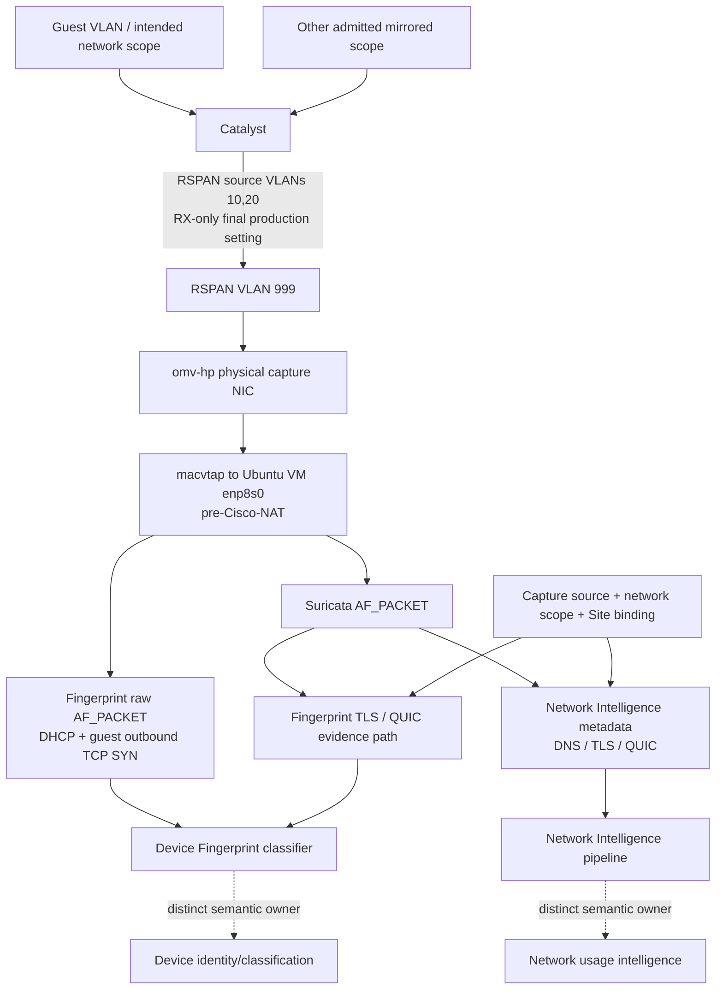

Shared observation infrastructure does not create a shared classifier or shared product meaning. Capture is proven pre-NAT; Network Intelligence must still enforce capture/network scope before Site/Device projection.

## NI-VIS-03 — NI-01 Ingestion Lifecycle

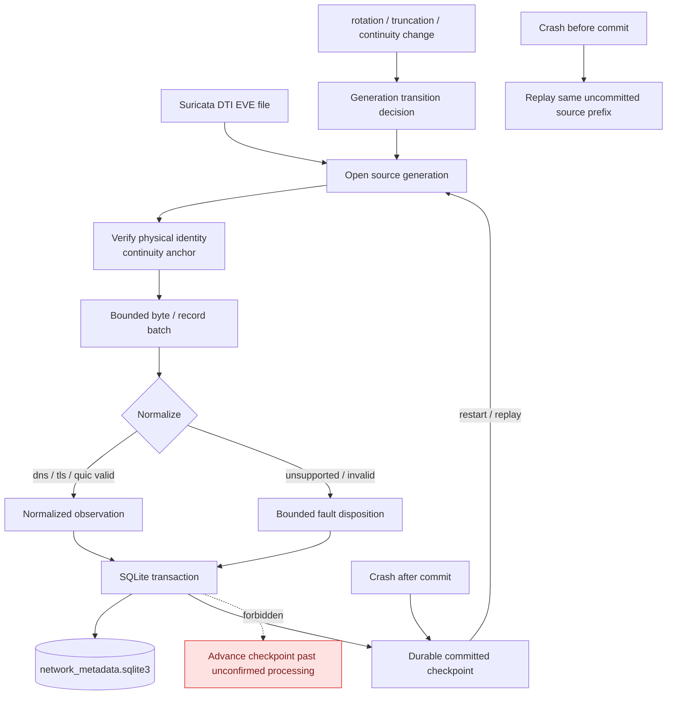

The scan position is disposable. The repository checkpoint is the durable authority. A checkpoint cannot safely advance past processing that has not committed.

## NI-VIS-04 — NI-02 / NI-02B Device Attribution

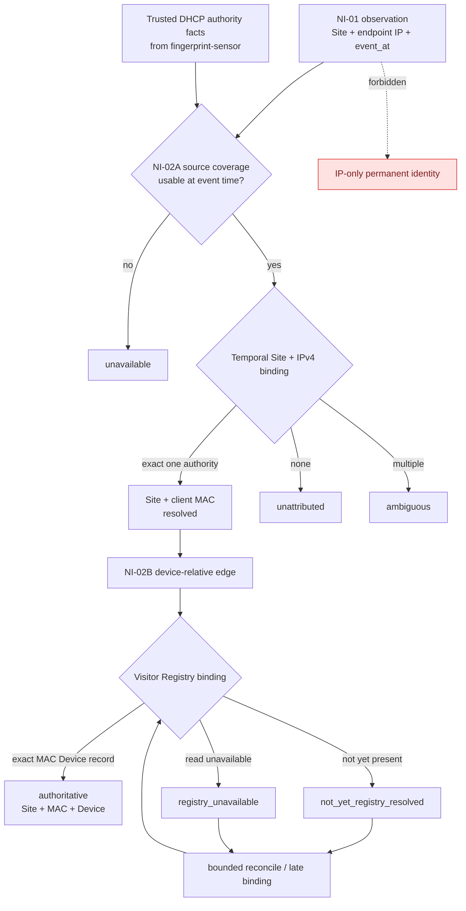

No heuristic nearest row, IP-only permanent identity, cross-MAC merge, or unproven attribution becomes an authoritative Device fact.

## NI-VIS-05 — Protocol Intelligence

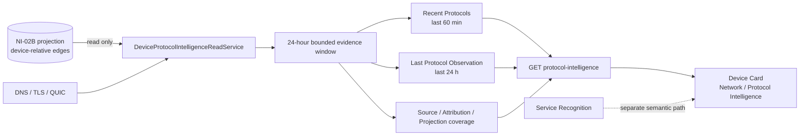

Protocol families are non-exclusive observations. NI-03 does not calculate service identity, traffic percentages, dominant protocol, or byte shares.

## NI-VIS-06 — Service Recognition Pipeline

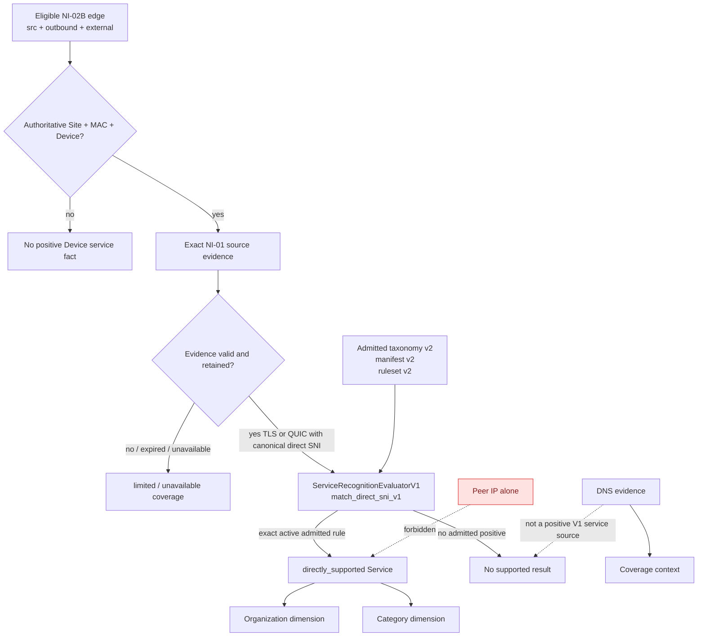

The current admitted runtime bundle is version 2: 55 active taxonomy services, 41 organizations, 10 categories and 53 active exact-SNI service rules. The research catalog is not itself a production-recognition claim.

## NI-VIS-07 — Background Materialization

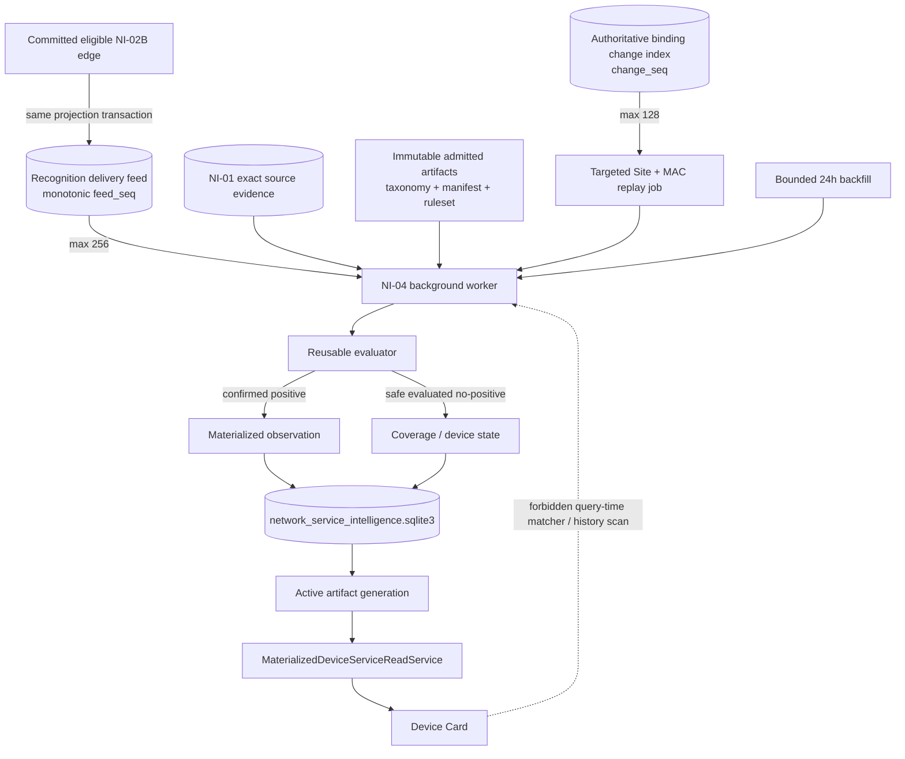

**Compute when evidence arrives → persist confirmed result → read the materialized result.**

## NI-VIS-08 — Data Stores and Ownership

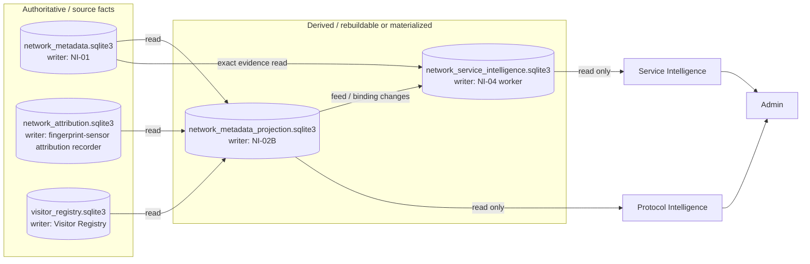

The projection/materialized stores do not replace NI-01 source provenance or existing Registry identity authority.

## NI-VIS-09 — Recognition Evidence and Confidence Semantics

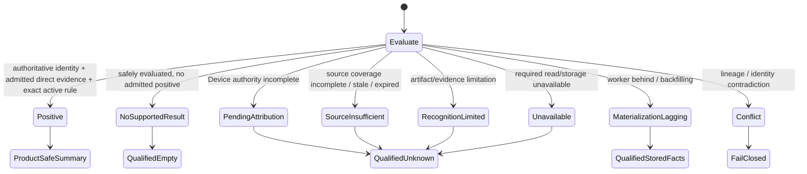

No supported service result is **not** proof that the Device had no Internet/network activity. Missing, stale, pending, insufficient and unavailable are not zero.

## NI-VIS-10 — Service / Organization / Category

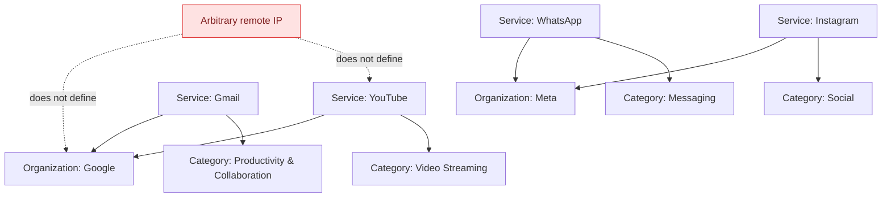

Service, Organization and Category are distinct taxonomy dimensions. Organization Context groups already recognized recent services; it does not independently infer an organization from a remote IP.

## NI-VIS-11 — Device Card User Experience

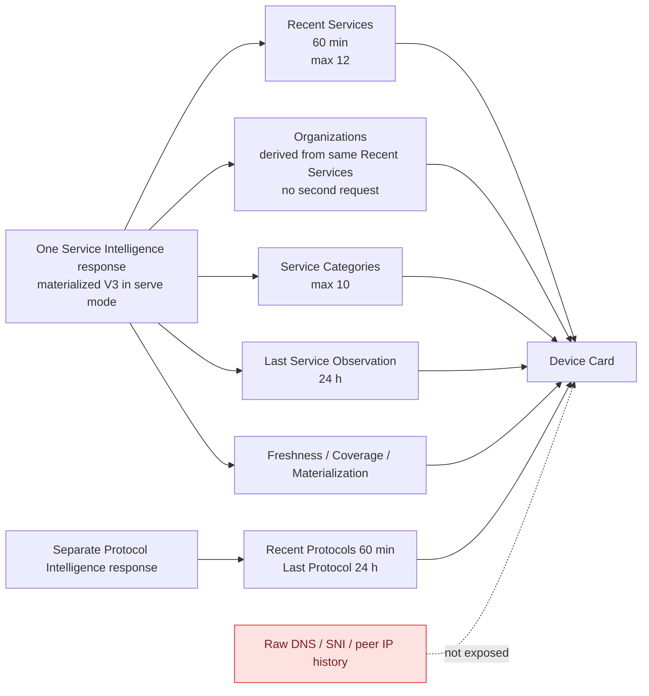

NI-05 Organization Context uses only confirmed entries already present in the bounded 60-minute Recent Services result. It does not query another database or create another network request.

## NI-VIS-12 — Read Path and Performance Boundary

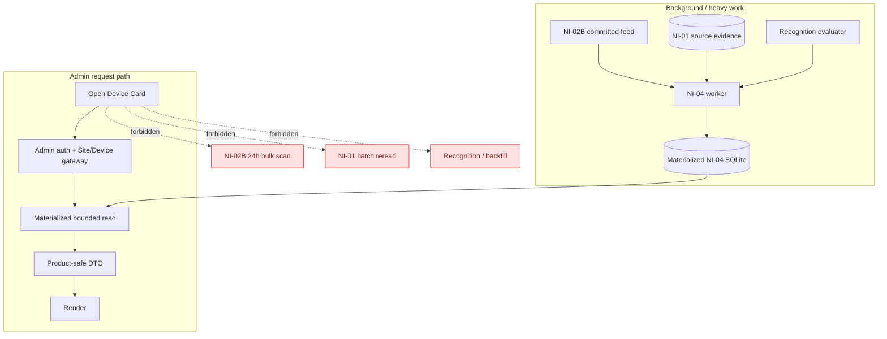

Serve mode opens only the NI-04 materialized SQLite after existing Admin authorization. Raising request-time deadlines is not the architecture.

## NI-VIS-13 — Process / Service Map

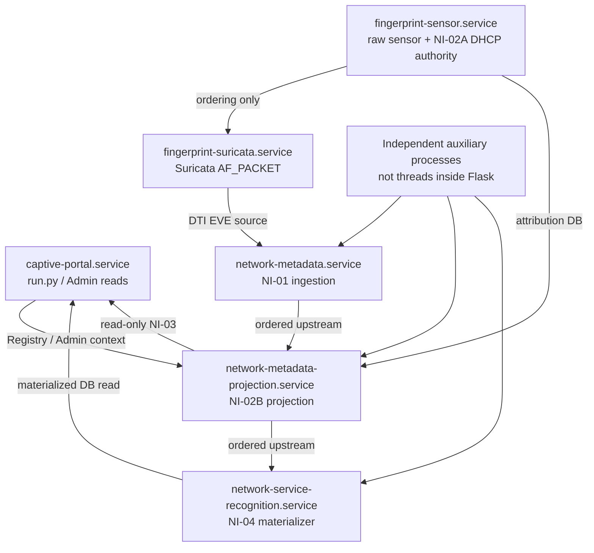

The production services are independently supervised. Their absence or lag must not become a hard dependency of guest authorization.

## NI-VIS-14 — Failure Isolation and Recovery

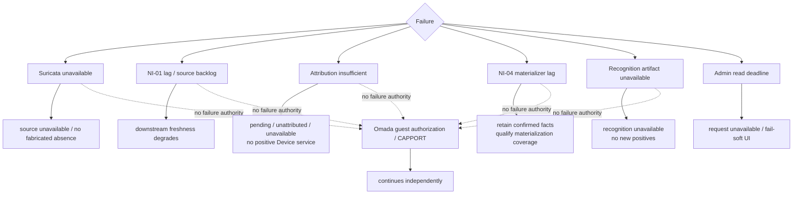

## NI-VIS-15 — Privacy / Security / Retention Boundary

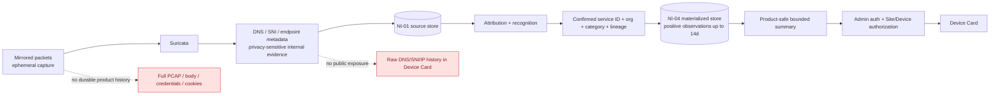

Metadata minimization does not make DNS/SNI/remote endpoint metadata non-sensitive. Product presentation exposes bounded semantic summaries, not raw history.

## NI-VIS-16 — Functional Closure / Roadmap

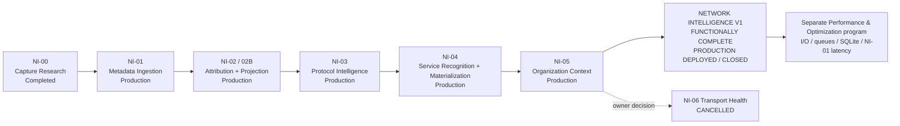

NI-06 is **Cancelled**, not Pending or HOLD. Performance optimization is a separate workstream and does not reopen Network Intelligence V1 functional scope.

## Production closure snapshot

| Stage | Current disposition |
|---|---|
| NI-00 | Completed |
| NI-01 | Production |
| NI-02 / NI-02B | Production |
| NI-03 | Production |
| NI-04 | Production |
| NI-05 | Production |
| NI-06 | **CANCELLED BY OWNER** |
| Network Intelligence V1 | **FUNCTIONALLY COMPLETE / PRODUCTION DEPLOYED / CLOSED** |

## Known Performance Work / Not a NI V1 Functional Blocker

A dated investigation on 2026-10-14 observed NI-01 ingestion lag of roughly 8–9 minutes while the storage subsystem was under pressure and SQLite physical reads were blocking. That observation is **not** a permanent SLA and is **not** proof of the current instantaneous lag. Read amplification remains a separate optimization hypothesis to verify. Functional closure does not claim that I/O optimization is complete, does not prescribe SSD as an architectural substitute, and does not weaken SQLite durability guarantees.
